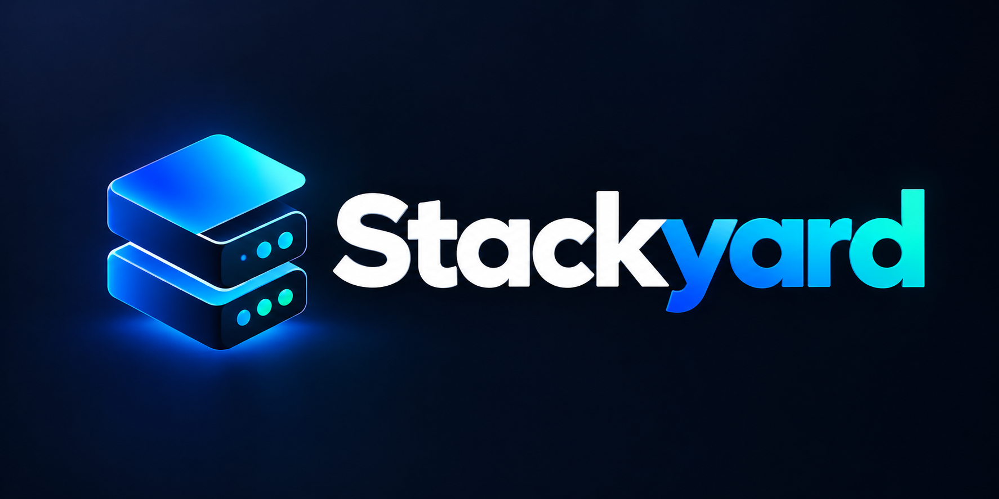

# Stackyard

> **Early preview — not generally available.** This is an experimental desktop app under active development. APIs, data layouts, and behaviour can change without notice. Use it on your own projects if you like, expect rough edges, and **suggestions are welcome**.

One desktop home for a multi-repo stack: bring apps and Docker infra up in order, keep Git in sync, run CI the way the server would, poke fault paths, and handle the rest of the day-to-day without juggling a dozen terminals.

Built with **Tauri 2** (Rust), **React 19**, **Vite 7**, and **Tailwind**.



## Status

| | |
| --- | --- |
| **Availability** | Not a public product release. No installers, support channel, or stability guarantees. |
| **Audience** | People who want to try the idea, poke at the code, or shape what comes next. |
| **Feedback** | Open to suggestions: missing workflows, CI quirks, UX friction, platform gaps — say what broke or what you wish existed. |
| **Safety** | Treat it as a local tool. Do not store production secrets you cannot afford to lose. Always keep your own backups of repos and data. |

## What it does today

| Area | Features |
| --- | --- |
| **Workspaces** | Group app services (local commands) and infra (Docker images). Shared env vars, per-profile overrides, dependency graph. |
| **Up pipeline** | Starts services in order, waits for ports, streams logs, stops everything cleanly. |
| **Git & Multi-repo** | Status across every repo in the workspace. Safe pull (fast-forward only). Named stashes, stash list, branch switch / create. |
| **CI Pipelines** | Local runner for **GitLab CI**, **GitHub Actions**, and **Jenkins**. Clean checkout, containers, services, artifacts, caches, rules / needs / matrix. Run a whole pipeline, picked jobs, or a single step. |
| **Plugins** | Drop Docker-backed infra into a workspace. Manage **CI runner images** (pull once, reuse; set the default). |
| **Fault injection** | HTTP / TCP proxy in front of a service: latency, errors, drops, hang. |
| **Terminals** | Per-app shell: Command Prompt, Windows PowerShell, PowerShell 7, or Git Bash. Loads your profile by default; optional init script. |
| **Storage** | Settings → Storage: see and wipe pipeline run files, caches, leftover containers, Docker build cache. Auto-prunes CI caches on startup. |

## What is still open

Ideas we know matter but are not “done”:

- Broader CI coverage (more actions / plugins, child pipelines, runners elsewhere).
- Hardening for large workspaces and long-running sessions (disk, logs, Docker leftovers).
- Packaging and updates for people who should not have to build from source.
- Cross-platform polish beyond the current Windows-first development path.

If something on that list (or off it) would change how you work, tell us.

## Requirements

- **Node.js** 20+ (24 recommended)
- **Rust** toolchain (stable) and [Tauri prerequisites](https://v2.tauri.app/start/prerequisites/) for your OS
- **Docker Desktop** (optional but recommended) for infra services and containerised CI jobs
- **Git for Windows** if you want Git Bash as a service terminal (Windows)

## Quick start

```bash
npm install
npm run tauri dev
```

Frontend only (no Tauri backend — most features need the desktop shell):

```bash
npm run dev
```

Production build (for your own machine; this is not a general public release):

```bash
npm run tauri build
```

Backend tests:

```bash
cd src-tauri
cargo test --lib
```

## Project layout

```
assets/           Brand artwork (logo, mark used for app icons)
public/           Favicon and static logo
src/              React UI (pages, components, state)
src-tauri/        Rust backend (services, Git, CI, Docker, storage)
  src/ci/         Pipeline parsers + runner (GitLab / GitHub / Jenkins)
  icons/          Generated app icons
```

App data (workspaces, settings, CI caches) lives under the OS app-data folder for identifier `com.stackyard.app` (e.g. `%APPDATA%\com.stackyard.app` on Windows). Workspaces and settings are never deleted by cleanup; only run files, caches, and managed Docker leftovers are.

## Typical workflow

1. **Create a workspace** and add repositories (auto-detects start command / port from `package.json`, `Cargo.toml`, etc.) or plugins for databases and similar.
2. Pick a **terminal** per app if you need PowerShell / Bash profiles or an init script.
3. **Up** the stack from the dashboard (optionally sync Git first).
4. Use **Git & Multi-repo** for stash / branch / pull across every repo.
5. Run **CI Pipelines** against a clean checkout; pull a runner image once from **Plugins**.
6. When disk space is tight, open **Settings → Storage & cleanup**.

## Known limits

- CI simulation is high-fidelity for common job shapes (stages, needs, rules, matrix, containers, services, artifacts, cache). It is not a full clone of every GitLab / GitHub / Jenkins feature.
- The first pull of a large runner image (e.g. `catthehacker/ubuntu:act-latest`) is big; after that it is reused.
- Pipeline runs are kept in memory for the session; finished-run files on disk are cleared at the next start and via Storage cleanup.
- Managed containers are named with the `dw-` / `dwci-` prefixes so leftover ones can be cleaned safely.
- Expect bugs, incomplete screens, and behaviour that changes as the preview evolves.

## License

Source is available for inspection and local use. This is **not** a generally available product, and there is no promise of support, SLAs, or a stable public API. Contributions and suggestions are welcome while the direction is still being shaped.
